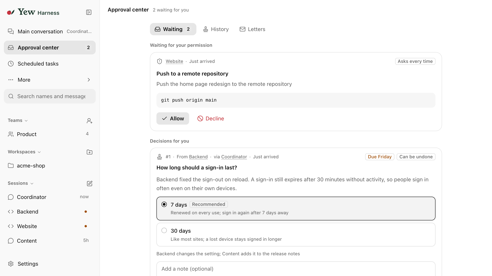
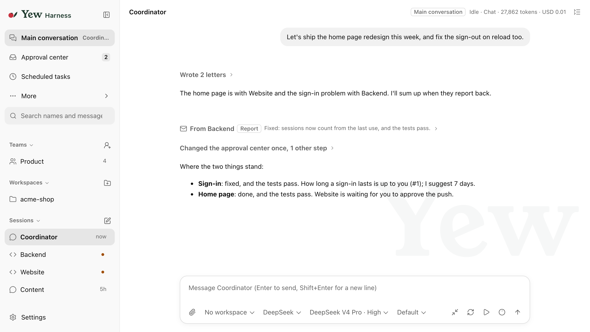
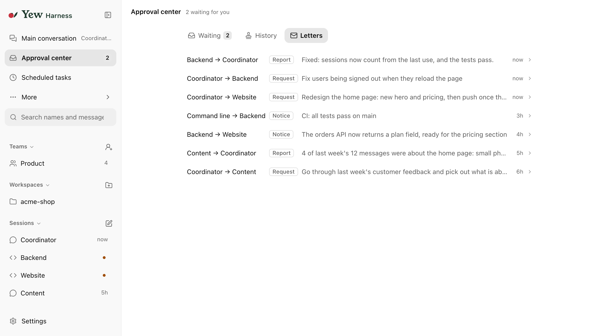
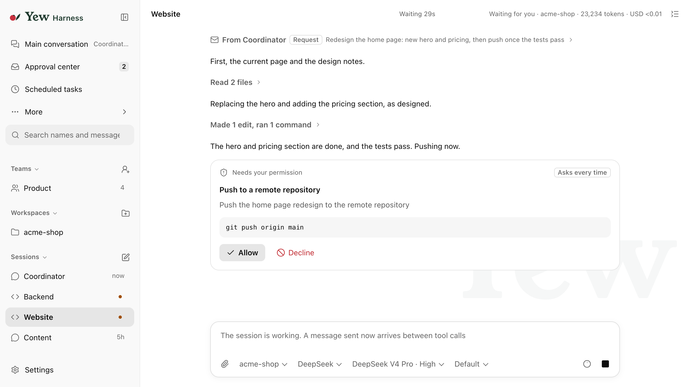
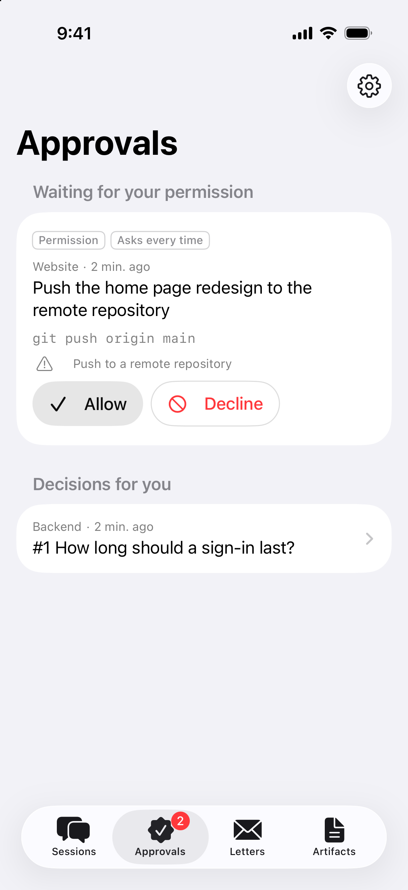

<p align="center">
  
</p>

<h1 align="center">Yew Harness</h1>

<p align="center">An AI-native multi-agent workbench</p>

<p align="center">
  <a href="https://www.npmjs.com/package/@tenonai/yew"></a>
  <a href="https://github.com/dozybot001/Yew/releases"></a>
  <a href="LICENSE"></a>
  
</p>

<p align="center">
  <a href="https://tenonai.cn/products/yew/">Website</a> · <a href="docs/">Docs</a> · <a href="https://github.com/dozybot001/Yew/releases">Releases</a> · <a href="README.zh-CN.md">简体中文</a>
</p>

<picture>
  <source media="(prefers-color-scheme: dark)" srcset="https://raw.githubusercontent.com/dozybot001/Yew/main/docs/assets/yew-approval-en-dark.png">
  
</picture>

Agent sessions organized the Session Engineering way: you deal only with the main conversation, and everything that needs your approval or decision comes to the approval center. Each session has a name, a responsibility, a workspace, a model and permissions, and sessions hand out work and report back through letters. They run in the Yew Harness service on your computer and keep working while the web page is closed.

## Quick start

You need macOS or Linux, Node.js 24 or later, and ripgrep (macOS: `brew install ripgrep`). On Linux, also install bubblewrap and socat (Debian, Ubuntu: `sudo apt install ripgrep bubblewrap socat`). On Windows, use WSL.

```bash
npm install -g @tenonai/yew
yew key set deepseek   # save an API key; DeepSeek is the default provider
yew serve --open       # start the service and open the web interface
```

The key goes into the system keychain only. For a new sign-in link later, run `yew open`. Optional: `yew service install` starts Yew Harness when you log in, and on macOS `yew app install` puts Yew Harness in Applications, opening in a window of its own with an icon in the Dock.

From source: clone the repository, then run `npm install`, `npm run build:web` and `npm link`.

## Features

- **Born for Session Engineering**: built on the idea and tuned for it throughout.
- **Multi-agent collaboration done well**: agents talk through A2A, an asynchronous mailbox, and you hardly notice it happening.
- **Take the boss’s chair for real**: approvals and decisions all sit in the approval center, and only your actions carry real authority.
- **Anywhere, anytime, off the desk**: approve from your phone; away from the computer, approvals and decisions still get handled.
- **Your choice of model**: model access is built on the open-source pi-ai library, with a huge range of model providers supported.

What else it does, version by version, is in the [changelog](CHANGELOG.md).

## Screenshots

<table>
  <tr>
    <td width="50%">
      <picture>
        <source media="(prefers-color-scheme: dark)" srcset="https://raw.githubusercontent.com/dozybot001/Yew/main/docs/assets/yew-main-en-dark.png">
        
      </picture>
    </td>
    <td width="50%">
      <picture>
        <source media="(prefers-color-scheme: dark)" srcset="https://raw.githubusercontent.com/dozybot001/Yew/main/docs/assets/yew-letters-en-dark.png">
        
      </picture>
    </td>
  </tr>
  <tr>
    <td width="50%">
      <picture>
        <source media="(prefers-color-scheme: dark)" srcset="https://raw.githubusercontent.com/dozybot001/Yew/main/docs/assets/yew-permission-en-dark.png">
        
      </picture>
    </td>
    <td width="50%" align="center">
      <picture>
        <source media="(prefers-color-scheme: dark)" srcset="https://raw.githubusercontent.com/dozybot001/Yew/main/docs/assets/yew-phone-en-dark.png">
        
      </picture>
    </td>
  </tr>
</table>

## Phone apps

The phone app connects only to the Yew Harness on your own computer: scan a QR code to pair, then follow sessions and handle the approval center on the phone. The two talk through a relay with end-to-end encryption; by default it is the relay Tenon AI runs, and you can run your own (see `relay/`).

- **Android**: the package (apk) is in the Releases on [GitHub](https://github.com/dozybot001/Yew/releases) and [Gitee](https://gitee.com/dozybot/yew/releases), signed by 长沙榫卯人工智能科技有限公司 (Tenon AI). The signing certificate's SHA-256 fingerprint is `9F:F5:6E:EA:A8:3C:DC:01:BA:66:D8:79:23:9C:DE:5A:2A:69:C3:AE:D2:60:5C:D8:E1:B9:34:8D:BF:28:61:B2`, also published on the [website](https://tenonai.cn/products/yew/#android); each release's notes give the package's SHA-256. If an update reports a signature mismatch, do not install it.
- **iPhone**: not in the App Store yet; it will come through TestFlight and the App Store.

## Documentation

The documents are written in Chinese.

- [The system sandbox](docs/sandbox.md): what sessions' commands can and cannot do (also in English)
- [Hooks](docs/hooks.md): commands of your own that run at set points of a session (also in English)
- [Data inventory](docs/data-inventory.md): what Yew Harness keeps on your computer, and how to delete it
- [Development conventions](AGENTS.md) and [changelog](CHANGELOG.md)

## Where your data goes

Yew Harness collects no data and contains no analytics or telemetry; sessions, messages and settings stay on your computer, and API keys stay in the system keychain. The model providers you choose receive the conversations sent to them, under their own privacy policies.

## Contributing

Issues and pull requests are welcome. See [CONTRIBUTING.md](CONTRIBUTING.md) and the [code of conduct](CODE_OF_CONDUCT.md).

## Security

Sessions' commands and the MCP servers you add run in a system sandbox, Anthropic's open-source [sandbox-runtime](https://github.com/anthropics/sandbox-runtime): they cannot touch Yew Harness's data or the keychain, write only in their workspace and temporary folders, and reach only allowed sites. Each session has a permission mode: the default asks before risky steps such as a command outside the sandbox; Auto leaves those to a separate check by the model first, and asks you directly about what cannot be taken back, such as publishing, messages to other people and production changes; Skip asks nothing, those included, and marks them in the record. [docs/sandbox.md](docs/sandbox.md) has the details, including what happens where the sandbox cannot start. Content from other sessions, web pages, mail and MCP servers is only data and cannot approve anything for you.

To report a security problem, see [SECURITY.md](SECURITY.md).

## License

[MIT](LICENSE). Copyright (c) 2026 Tenon Artificial Intelligence Technology Co., Ltd. (长沙榫卯人工智能科技有限公司)

The third-party packages used at run time and in the web interface are listed in [THIRD-PARTY-NOTICES.md](THIRD-PARTY-NOTICES.md).

Names, logos and the character: the Yew Harness, Yew and Tenon AI names and logos, including the icons in `web/public/icons/` and `ios/Yew/Assets.xcassets/`, and the design and images of the character Yew, including the images in `web/public/mascot/` and `android/app/src/main/res/drawable-nodpi/` and the Mascot images in `ios/Yew/Assets.xcassets/`, are not licensed under the MIT License. You may refer to the names as they are to say that you use Yew Harness or that your work is based on it, but do not use the names or logos as the name or logo of your own product, do not use the character's design or images in your own product, and do not suggest that your product comes from or is endorsed by Tenon AI.

---

<p align="center">
  Publisher&emsp;<a href="https://tenonai.cn/"> Tenon AI</a>
</p>
