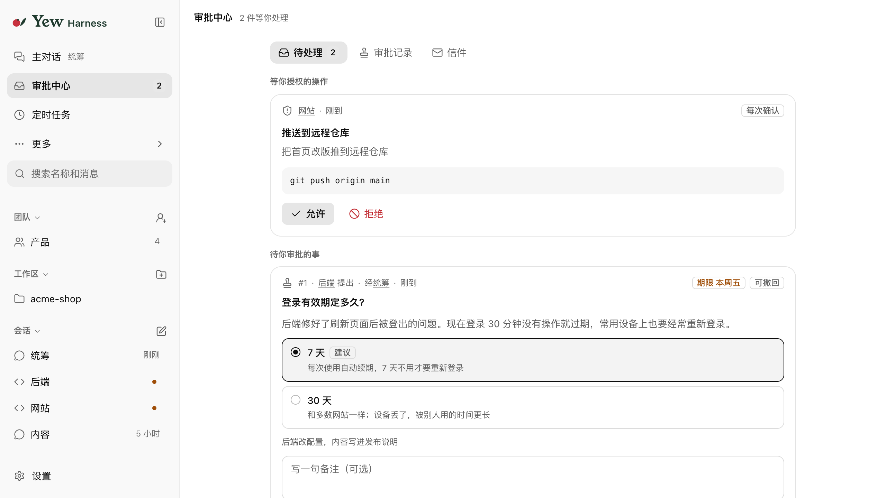
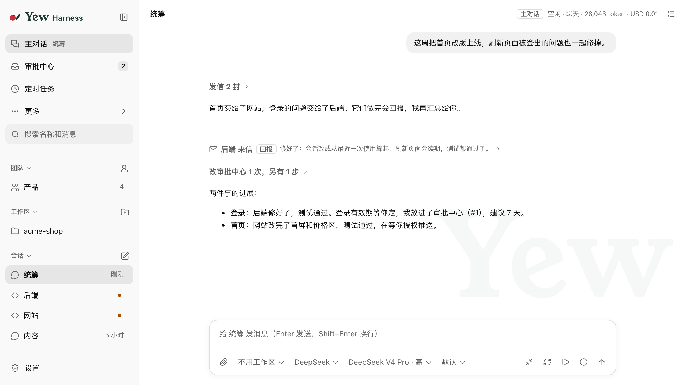
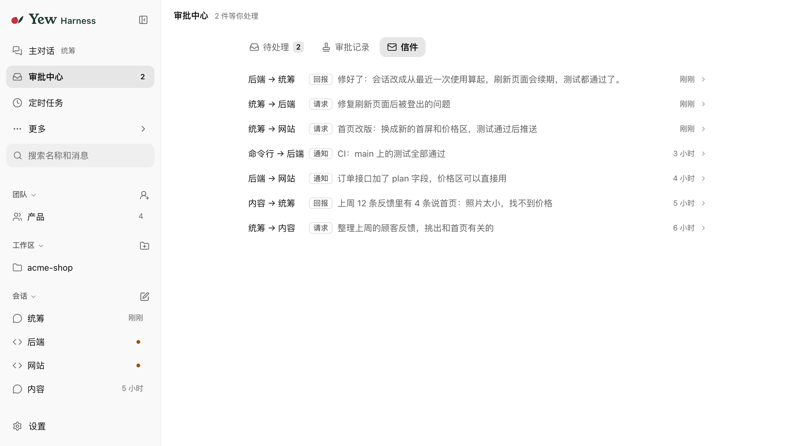
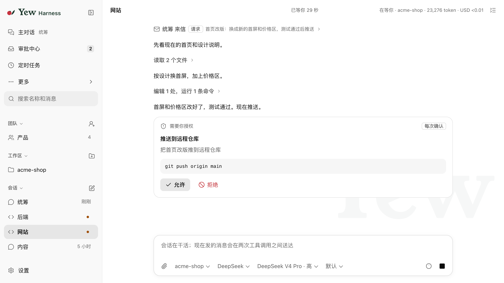
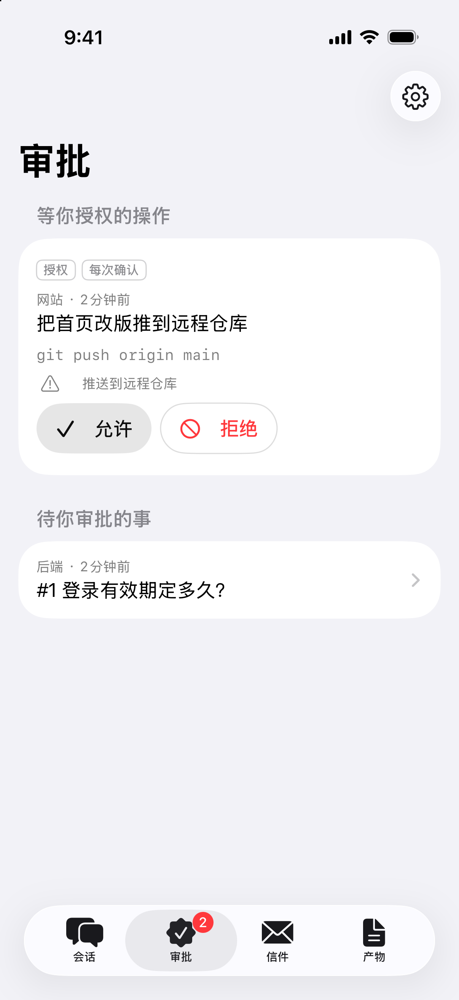

<p align="center">
  
</p>

<h1 align="center">Yew Harness</h1>

<p align="center">AI 原生的多 Agent 工作台</p>

<p align="center">
  <a href="https://www.npmjs.com/package/@tenonai/yew"></a>
  <a href="https://github.com/dozybot001/Yew/releases"></a>
  <a href="LICENSE"></a>
  
</p>

<p align="center">
  <a href="https://tenonai.cn/zh/products/yew/">官网</a> · <a href="docs/">文档</a> · <a href="https://gitee.com/dozybot/yew/releases">Releases</a> · <a href="README.md">English</a>
</p>

<picture>
  <source media="(prefers-color-scheme: dark)" srcset="docs/assets/yew-approval-zh-dark.png">
  
</picture>

按 Session Engineering 的做法组织 Agent 会话：你只对接主对话，要你授权和决定的事都汇到审批中心。每个会话有名字、职责、工作区、模型和权限，会话之间用信件分派和回报。会话跑在你电脑上的 Yew Harness 服务里，网页关了也照常干活。

## 快速开始

需要 macOS 或 Linux、Node.js 24 或更高版本和 ripgrep（macOS：`brew install ripgrep`）；Linux 上还要 bubblewrap 和 socat（Debian、Ubuntu：`sudo apt install ripgrep bubblewrap socat`）。Windows 请在 WSL 里使用。

```bash
npm install -g @tenonai/yew
yew key set deepseek   # 存入 API Key，默认服务商是 DeepSeek
yew serve --open       # 启动服务，打开网页界面
```

Key 只存进系统钥匙串。以后需要新的登录链接，运行 `yew open`。可选：`yew service install` 让 Yew Harness 登录后自动启动；macOS 上 `yew app install` 在「应用程序」里放 Yew Harness 应用，在它自己的窗口里打开，Dock 上有图标。

从源码运行：克隆仓库后 `npm install`、`npm run build:web`、`npm link`。

## 功能

- **为 Session Engineering 而生**：按这套理念构建，并且处处为它优化。
- **出色的多 Agent 协作体验**：基于异步信箱机制 A2A，让 Agent 交流很无感。
- **真正坐进办公室当老板**：授权与决定都在审批中心，你的操作才有实权。
- **随时随地，打破工位枷锁**：手机也能审批，人不在电脑前，授权和决定照样处理。
- **模型随你选**：接入库用开源的 pi-ai，支持超级多家模型服务商。

每个版本还加了什么，见[更新记录](CHANGELOG.md)。

## 截图

<table>
  <tr>
    <td width="50%">
      <picture>
        <source media="(prefers-color-scheme: dark)" srcset="docs/assets/yew-main-zh-dark.png">
        
      </picture>
    </td>
    <td width="50%">
      <picture>
        <source media="(prefers-color-scheme: dark)" srcset="docs/assets/yew-letters-zh-dark.png">
        
      </picture>
    </td>
  </tr>
  <tr>
    <td width="50%">
      <picture>
        <source media="(prefers-color-scheme: dark)" srcset="docs/assets/yew-permission-zh-dark.png">
        
      </picture>
    </td>
    <td width="50%" align="center">
      <picture>
        <source media="(prefers-color-scheme: dark)" srcset="docs/assets/yew-phone-zh-dark.png">
        
      </picture>
    </td>
  </tr>
</table>

## 手机端

手机上的 Yew Harness 只连接你自己电脑上的 Yew Harness：扫码配对，之后在手机上看会话、处理审批中心里的事。两端经中继通信，内容端到端加密；默认用 Tenon AI 运行的中继，也可以自己部署（见 `relay/`）。

- **安卓**：安装包（apk）在 [GitHub](https://github.com/dozybot001/Yew/releases) 和 [Gitee](https://gitee.com/dozybot/yew/releases) 的 Releases 里，由长沙榫卯人工智能科技有限公司签名。签名证书的 SHA-256 指纹是 `9F:F5:6E:EA:A8:3C:DC:01:BA:66:D8:79:23:9C:DE:5A:2A:69:C3:AE:D2:60:5C:D8:E1:B9:34:8D:BF:28:61:B2`，也公布在[官网](https://tenonai.cn/zh/products/yew/#android)上；每个版本的说明里有安装包的 SHA-256。更新时系统如果提示签名不一致，不要安装。
- **iPhone**：还没有上架，之后经 TestFlight 和 App Store 发布。

## 文档

- [系统沙箱](docs/sandbox.md)：会话的命令能做什么、不能做什么
- [hooks](docs/hooks.md)：在会话的几个时候跑你自己的命令
- [数据清单](docs/data-inventory.md)：Yew Harness 在你电脑上存了哪些数据、怎么删除
- [开发约定](AGENTS.md)、[更新记录](CHANGELOG.md)

## 数据去向

Yew Harness 不收集任何数据，也不含统计和遥测；会话、消息和设置存在你自己的电脑上，API Key 存在系统钥匙串里。你选用的模型服务商会收到发给它的对话内容，适用它自己的隐私政策。

## 参与贡献

欢迎提 issue 和 pull request，做法见 [CONTRIBUTING.md](CONTRIBUTING.md) 和[行为准则](CODE_OF_CONDUCT.md)。

## 安全

会话的命令和你自己加的 MCP 服务器在系统沙箱里运行，用的是 Anthropic 开源的 [sandbox-runtime](https://github.com/anthropics/sandbox-runtime)：碰不到 Yew Harness 的数据和钥匙串，只能写工作区和临时文件夹，只能连放行的网站。每个会话选一种授权方式：默认方式下，在沙箱外运行这类有风险的步骤先问你；自动方式先交给一次单独的模型检查，对外发布、给别人发消息、改生产环境这类做错了收不回的事不交给检查，直接问你；跳过方式什么都不问，这些事也直接执行，在记录里标出来。详情见 [docs/sandbox.md](docs/sandbox.md)，包括沙箱起不来时怎样。别的会话的信、网页、邮件和 MCP 返回的内容只当作数据，不能替你授权。

报告安全问题见 [SECURITY.md](SECURITY.md)。

## 许可证

[MIT](LICENSE)。Copyright (c) 2026 Tenon Artificial Intelligence Technology Co., Ltd. (长沙榫卯人工智能科技有限公司)

运行时依赖和网页界面里用到的第三方包见 [THIRD-PARTY-NOTICES.md](THIRD-PARTY-NOTICES.md)。

名称、标志和角色：Yew Harness、Yew 和榫卯 Tenon AI 的名称和标志（包括 `web/public/icons/`、`ios/Yew/Assets.xcassets/` 里的图标），以及角色 Yew 的形象和图片（包括 `web/public/mascot/`、`android/app/src/main/res/drawable-nodpi/` 里的图片和 `ios/Yew/Assets.xcassets/` 里 Mascot 开头的图片），不在 MIT 许可证的授权范围内。你可以照原样提到这些名称，说明你在使用 Yew Harness 或基于它修改；但不要把这些名称和标志用作你自己产品的名称或标志，不要在你自己的产品里使用 Yew 的形象和图片，也不要让人以为你的产品来自榫卯 Tenon AI 或得到它的认可。

---

<p align="center">
  出品方　<a href="https://tenonai.cn/"> 榫卯 Tenon AI</a>
</p>
